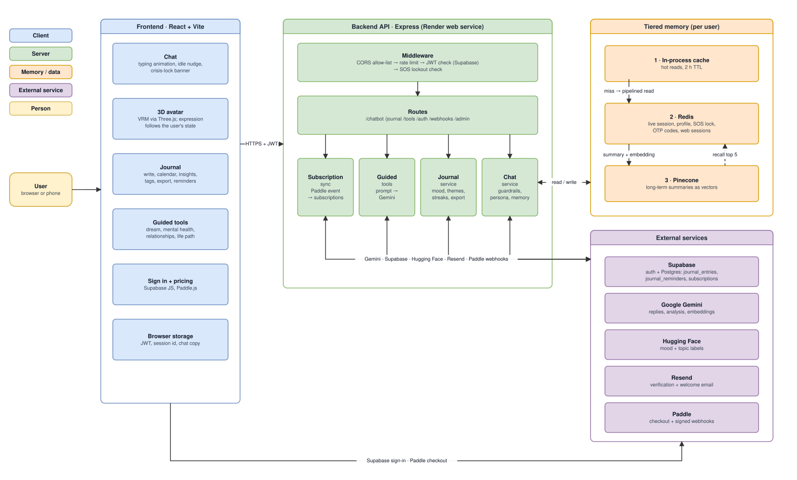
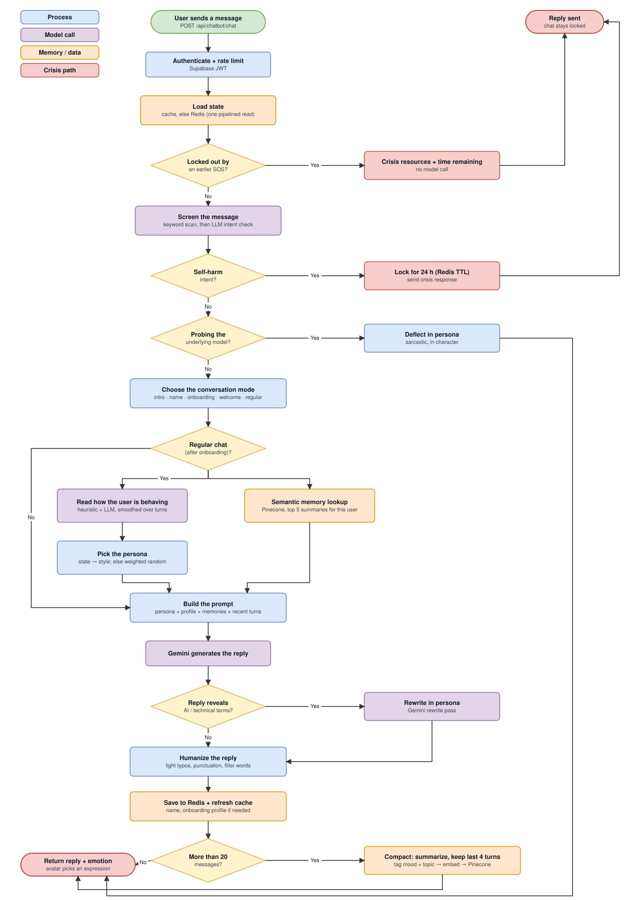

# Lumaya — AI Companion for Mental Clarity & Emotional Growth

Lumaya is a full-stack AI companion app: supportive chat that remembers you across sessions, a private journal with mood tracking, guided self-reflection tools, and a 3D animated avatar that reacts to the conversation.

> Lumaya is an AI wellness companion, not a licensed therapist or a substitute for professional care. It started life as a crypto wallet tracker and was pivoted into Lumaya; see [Known gaps](#known-gaps) for the few leftovers.

## Demo

https://github.com/user-attachments/assets/ca1663ec-ca27-4c5b-90e9-d77a68fd5429

## Features

- **Chat companion** — Gemini-powered conversation with tiered memory (see [Architecture](#architecture)), so it can pick up where you left off weeks later
- **Behavior-aware personas** — five therapeutic styles (questioning, hard truths, brief, solution-focused, interrogative); the style is chosen from how you're coming across in the moment, not at random
- **3D avatar** — an animated VRM avatar (Three.js + `@pixiv/three-vrm`) beside the chat. It blinks, breathes, moves its mouth while Lumaya's reply types out, and shows an expression that follows your detected state. Shown on screens 1024 px and wider; can be hidden
- **Journal** — write with an AI-generated prompt and get a reflective reply; browse by calendar, search, tag, and export (Markdown, text, CSV, JSON). Mood trend chart, streaks, insights, and an in-app daily reminder
- **Guided tools** — Dream Interpreter, Life Prediction, Relationship Coaching, Mental Health Plan generator
- **Safety and scope guardrails** — self-harm detection that shows crisis resources and pauses the chat for 24 hours; playful in-character deflection of maths, code, puzzles, homework, translation, trivia, jailbreaks, and "which model are you?" questions
- **Idle nudges** — a gentle follow-up question if you pause mid-conversation
- **Auth & accounts** — email + OTP verification, Supabase auth, protected routes
- **Payments** — Paddle webhook keeps a `subscriptions` table in sync (see [Known gaps](#known-gaps) for the pricing page)

## Architecture

### System overview



### How a chat message is handled



### Memory

Three tiers keep context across turns, sessions, and weeks:

| Tier | Holds | Notes |
|---|---|---|
| In-process cache | Hot per-session reads (block status, session, profile) | 2 h TTL; falls back to Redis on a miss |
| Redis | Live session context, user profile, SOS lock, OTP codes, web sessions | A cache miss triggers one pipelined read |
| Pinecone | Per-user long-term memory | Summaries stored as 1024-dim vectors, filtered by user id |

**Write path.** When a session passes 20 messages, older turns are compacted into a Gemini summary and the last four stay verbatim. The summary is tagged with a mood and topic (Hugging Face), embedded (Gemini), and stored in Pinecone. Starting a "New Session" does the same and seeds the next session with that summary.

**Read path.** After onboarding, every message triggers a semantic lookup of that user's most relevant past summaries, injected into the prompt next to the profile.

### Personas

The system prompt is built per turn from the user's state: first contact, name request, onboarding, welcome-back, or regular chat. In regular chat Lumaya reads how you're presenting and picks a style:

| You seem… | Style |
|---|---|
| distressed or overwhelmed | brief |
| guarded, giving minimal answers | questioning |
| to want a way forward | solution-focused |
| to be circling the same story | hard truths |
| open and reflective | interrogative |
| no clear signal | weighted random across the five |

The read combines a fast offline heuristic with an LLM check and is smoothed over turns, so sustained distress isn't dropped after one calmer message. Hard truths are held back until there's rapport (4+ turns) and never used while someone is struggling. Each style adapts its language to the user's age, occupation, and gender from their profile. Set `PERSONA_STATE_DETECTION=off` to skip the LLM check.

### Guardrails

**Safety.** Every message passes a keyword screen followed by an LLM intent check. A confirmed self-harm intent shows crisis resources and locks the chat for 24 hours (Redis TTL). The lock is enforced on chat, nudges, and the guided tools. An operator can list and lift locks through `/api/admin/*` (see [Admin](#admin)).

**Scope.** Lumaya is a companion, not an assistant, so people can't use it as a free general-purpose model. Alongside the safety screen, one LLM call reads the message and labels whether the user is asking for a task rather than talking. The task labels are `math`, `code`, `puzzle`, `homework`, `translation`, `trivia`, `jailbreak` ("ignore your instructions", "pretend you are…") and `model_probe` ("which LLM are you?"). A flagged message gets a short, playful, in-character deflection that never answers the question ("Numbers and I have a complicated relationship…"), and steers back to how the person feels. It's layered, so no single piece has to be perfect:

1. **Offline patterns** ([`taskGuard.js`](./backend/src/services/taskGuard.js)) catch the obvious cases instantly and still work if the model is down. They're tight and directive, so someone saying "I have a maths exam and I'm terrified" or "my job is coding and I'm burnt out" is never deflected.
2. **The LLM read** catches subtle ones the patterns miss. It can add a task label but can't remove one the patterns are sure about. If it fails or returns junk, the patterns decide alone.
3. **People who are distressed are never deflected for asking something** (jailbreaks excepted).
4. **A scope reminder** is appended to every chat prompt, and to the guided-tool prompts, as a second line of defence if something slips through. If the model tries to answer a deflected maths question anyway, the reply is replaced with a safe canned line.

This runs in parallel with the safety screen and the memory lookup, and shares one model call with the persona's state read, so it adds no extra round-trip on the critical path. `PERSONA_STATE_DETECTION=off` turns off the LLM read; the offline patterns keep guarding.

Replies are also checked so they don't break persona, and lightly humanized (occasional typos, punctuation, filler words).

## Tech stack

**Frontend** — React 18, Vite, React Router, Tailwind CSS (scoped, see below), Three.js + `@pixiv/three-vrm`, react-calendar, Framer Motion, Supabase JS, Paddle.js

**Backend** — Node.js 18+, Express, Redis (`ioredis`, `redis`, `connect-redis`), Pinecone, Google Generative AI SDK, Paddle Node SDK, Resend, `express-rate-limit`

**Data** — Supabase (Postgres + Auth); SQL in [`supabase/migrations`](./supabase/migrations)

> **Tailwind is scoped.** Pages that use their own CSS (Home, Chat, Auth, Navbar, Footer) are left alone. Tailwind-styled pages (About, Chat Guide, Privacy, Journal, the guided tools) render inside a `<Tw>` wrapper in `App.jsx`, and every utility is emitted as `.tw .utility`. If you add a Tailwind page, wrap its route in `<Tw>`.

## Project structure

```
├── frontend/                 React + Vite app
│   └── src/
│       ├── components/       Pages and UI (ChatInterface, AvatarPanel, VrmViewer, tools, ...)
│       │   └── journal/      Journal page: Write, History, Insights, Reminders
│       ├── hooks/            useMessages, useSession, useNudge, ...
│       ├── services/         apiClient (one fetch wrapper) + chat, journal, auth, tools
│       └── App.jsx
├── backend/
│   ├── src/
│   │   ├── routes/           chat, journal, tools, auth, webhooks, admin, sitemap
│   │   ├── services/         chat, memory, userState (personas), journal, subscription, ...
│   │   ├── middlewares/      auth, admin, SOS lockout, rate limiters
│   │   └── app.js
│   └── test/                 node:test unit tests
├── supabase/migrations/      journal, subscriptions, and the original schema
├── docs/                     architecture.drawio + exported SVGs
├── media/                    demo assets
└── render.yaml               Render Blueprint
```

## Getting started

### Prerequisites

- Node.js 18+ (CI runs 22)
- A Redis instance (local or hosted, e.g. Upstash)
- Accounts and keys for Supabase, Google Gemini, Pinecone, Hugging Face, Resend, and Paddle

### 1. Install

```bash
cd frontend && npm install
cd ../backend && npm install
```

### 2. Configure

Copy the examples and fill them in (both real files are gitignored):

```bash
cp frontend/.env.example frontend/.env.local
cp backend/.env.example backend/.env
```

The frontend needs only public values (`VITE_SUPABASE_URL`, `VITE_SUPABASE_ANON_KEY`, `VITE_PADDLE_CLIENT_TOKEN`, `VITE_API_BASE_URL`, ...). **All model calls happen on the backend**, so there is no Gemini key in the browser. Never put a secret in a `VITE_` variable.

Optional backend variables: `GEMINI_MODEL`, `GEMINI_EMBEDDING_MODEL`, `PERSONA_STATE_DETECTION`, `PADDLE_ENV`, `FRONTEND_ORIGINS`, `ADMIN_USER_IDS`. See [`backend/.env.example`](./backend/.env.example).

### 3. Set up the database and vector index

1. Run the SQL files in [`supabase/migrations`](./supabase/migrations) in order (Supabase CLI `supabase db push`, or paste them into the SQL editor). The `journal`, `subscriptions`, and `retire_wallet_trigger` migrations are the ones Lumaya needs. The four earlier files are the original wallet schema.
2. Create a Pinecone index with **1024 dimensions** (the embedding is truncated to 1024) and put its name in `PINECONE_INDEX2`.

### 4. Run

```bash
# backend (Express API on :3000)
cd backend && npm run dev       # auto-restarts on change; `npm start` for plain node

# frontend (Vite on :5173)
cd frontend && npm run dev
```

### 5. Test

```bash
cd backend && npm test          # guardrails, personas, webhook, journal logic
cd frontend && npm run build    # type/bundle check
```

CI runs both on every push and pull request.

## API overview

| Route | Purpose |
|---|---|
| `POST /api/auth/signup/initiate` · `/complete` · `/signin` · `/signout` · `GET /user` | OTP sign-up, sign-in, sign-out |
| `POST /api/chatbot/chat` · `/refresh-session` · `/nudge` | Conversation, new session, idle nudge |
| `POST /api/tools/generate` | Guided tools (`dream`, `mental-health`, `life-prediction`, `relationship`) |
| `/api/journal/*` | Entries, calendar, search, tags, stats, streak, mood analysis, insights, summary, export, reminders |
| `POST /api/webhooks/paddle` | Signed Paddle subscription events |
| `/api/admin/*` | Lockout administration (admin only) |

All routes except sign-up, sign-in, and the Paddle webhook require a Supabase JWT (`Authorization: Bearer …`). Chat, nudge, tools, and journal are rate limited per user.

### Admin

Set `ADMIN_USER_IDS` to a comma-separated list of Supabase user ids, then:

- `GET /api/admin/blocked-users` — everyone currently locked
- `GET /api/admin/users/:userId/block-status`
- `POST /api/admin/users/:userId/unblock` — lift a lock early

## Deployment (Render)

[`render.yaml`](./render.yaml) provisions two services:

- **`lumaya-backend`** — Node web service, root `backend/`, `npm install` → `npm start`
- **`lumaya-frontend`** — static site, root `frontend/`, `npm install && npm run build`, publish `dist/`, SPA rewrite to `index.html`

1. In the [Render dashboard](https://dashboard.render.com), choose **New → Blueprint** and point it at this repo.
2. Fill in the variables marked `sync: false` (Supabase, Gemini, Pinecone, Hugging Face, Paddle, Resend, `ADMIN_USER_IDS`, ...).
3. Add a Redis instance (Render Key Value or Upstash) and set `REDIS_URL` on the backend.
4. Once both are live, set `VITE_API_BASE_URL` on the frontend to the backend URL and `FRONTEND_URL` on the backend to the frontend URL (CORS is built from it), then redeploy.

The Paddle webhook verifies the raw request body, so it is mounted before the JSON parser. Set `PADDLE_ENV=sandbox` while testing with Paddle's sandbox.

